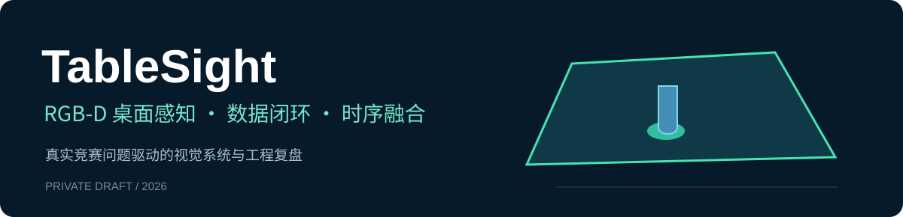
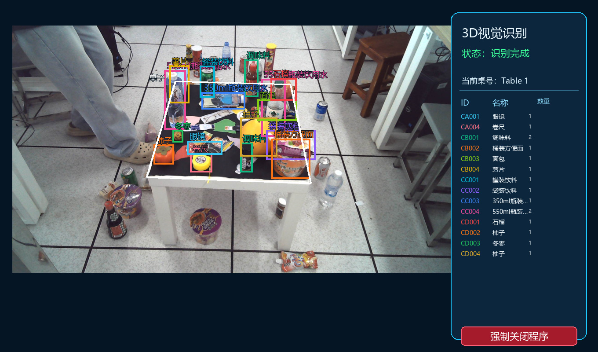
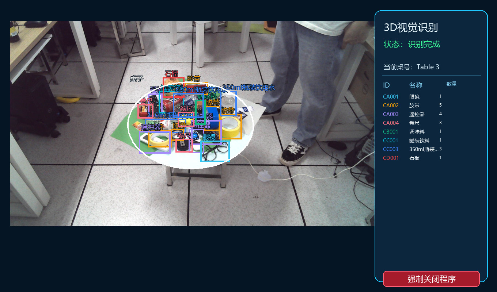
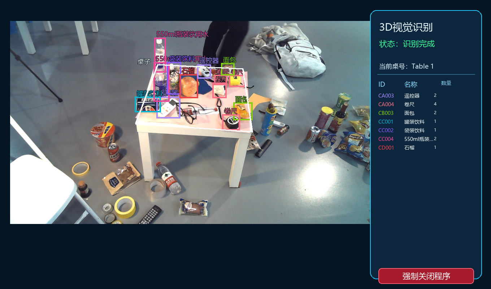
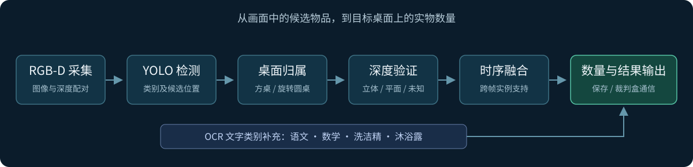

# TableSight｜RGB-D 桌面物品识别与计数

**让机器人看清桌上有什么，也分清哪些东西真正属于这张桌子。**

机器人视觉竞赛项目 · **国家二等奖**（团队成绩）  
`计算机视觉` · `YOLOv8m` · `RGB-D` · `OCR` · `Ascend 边缘部署`

TableSight 面向静止方桌和旋转圆桌，融合图像、深度与连续帧信息，输出桌面物品的类别和数量。项目从数据标注、模型训练一路落地到香橙派上的实机运行。

[8 个视觉案例](docs/技术复盘.md) · [数据与模型](docs/数据与模型.md) · [代码与运行](docs/运行说明.md)

## 界面展示

以下图片为**根据历史照片与人工标注绘制的 UI 示意图**。物品框、类别和数量来自对应标注；圆桌轮廓为二维拟合示意，不是模型预测或深度过滤实测。

### 方桌：整体界面

查看圆桌界面与小桌面轮廓

查看包含桌外干扰的方桌场景

## 我负责什么

我是项目的**主要负责人**，负责**全部代码构建、数据集拍摄建议与图像标注**。

- **代码与系统集成**：构建检测、桌面定位、深度过滤、OCR、时序计数相关代码，完成板端集成与调试。
- **数据建设**：根据误检和漏检提出补拍建议，覆盖不同距离、视角、遮挡、小物品和现场背景，并承担图像标注。
- **问题排查与迭代**：结合逐帧记录和历史结果定位错误，在模型、几何筛选和时序规则之间选择修改位置。

维护者：[rickyx123](https://github.com/rickyx123)

## 为什么不能只跑一次 YOLO

比赛现场的困难不止是认出物品：地上的薯片也能被检测出来，贴纸可能和实物外观一样，转动中的眼镜又不一定每帧都能看见。最终任务要求的是**桌上实物的准确计数**。

| 现场问题 | 系统中的处理思路 |
|---|---|
| 桌后堆高的物品，看起来与桌面齐平 | 结合桌面几何与实际边界判断归属 |
| 物品照片被当成真实物体 | 用深度证据辅助判断立体与平面，保留深度未知状态 |
| 圆桌旋转、遮挡造成间歇漏检 | 汇总跨帧实例，以有效桌面观测作为计票依据 |
| 到现场后，模型对距离和背景不适应 | 按失败场景补拍、标注、重采样与微调，再做同集比较 |
| 文字标签定义物品类别 | OCR 识别语文、数学、洗洁精和沐浴露，并结合空间位置处理 |

## 系统如何工作

设备采用 **Orange Pi AI Pro / Ascend 310B4 + Astra Pro RGB-D 相机**。YOLO 检测在 NPU 上运行，深度几何、时序融合和 OCR 配合完成最终判断。模型经过 PT → ONNX → OM 转换，部署时核对类别顺序和前后处理。

## 三个有代表性的技术问题

### 1. 检测到了物品，为什么仍然不能计入？

桌后的物品可以被垫到与桌面相近的高度；单看检测框或深度高度，都可能把它误算进去。方桌方案保留透视下的梯形边界，将桌面支撑范围与物品归属分开判断，重点处理容易被干扰物“拉出去”的后沿。

这段调试让我认识到：**物体类别识别和物体支撑关系判断，是两个不同的问题。**

### 2. 为什么视频里经常能看到，最后却少算？

旋转会改变物品外观和遮挡关系，桌面检测也会短暂丢失。若所有采集帧都进入分母，就会惩罚没有有效桌面观测的时刻；若只累加框，又会重复计数。系统结合有效桌面帧、实例支持和类别差异进行聚合，并针对眼镜等随角度明显变化的物品调整确认规则。

### 3. 为什么补拍比继续调置信度更有效？

现场的地板、距离、光照和摆放方式改变了图像分布。我们围绕实际失败场景补拍和标注，提高现场困难样本的采样频率，再从上一版本微调，同时保留旧场景验证，检查有没有顾此失彼。

## 模型迭代取得了什么提升

| 同集对比 | 验证图像 | mAP50–95 | 提升 |
|---|---|---:|---:|
| V6 → V7 | 固定验证集，718 张 | 64.58% → 68.92% | **+4.34 个百分点** |
| V7 → V8 | 现场验证集，149 张 | 51.80% → 71.73% | **+19.93 个百分点** |
| V8 → V9 | 新现场验证集，57 张 | 56.64% → 68.62% | **+11.97 个百分点** |

以上均为 832 输入、各行内部同一组图像的比较；版本号表示项目权重迭代，基础架构均为 YOLOv8m。提升来自数据、标注、采样和微调的共同变化。验证集参与过模型选择，这些检测指标不等同于整套系统的比赛准确率。完整结果及旧专项回退见[数据与模型](docs/数据与模型.md)。

## 从这个项目中积累的能力

- **视觉系统构建**：把检测、深度、文字与时间信息组织成可运行的感知流程。
- **数据驱动迭代**：从失败样本提出补拍方案，处理标注与类别一致性，检验新旧场景表现。
- **边缘工程落地**：处理模型转换、相机采集、异步任务与前后处理一致性。

我希望继续研究**机器人视觉、RGB-D 几何感知，以及遮挡和深度缺失下的稳健感知**。

## 查看代码与进一步阅读

| 想了解什么 | 入口 |
|---|---|
| 几何、深度和时序设计 | [8 个视觉案例](docs/技术复盘.md) |
| 如何补拍、标注、加权与验证 | [数据与模型](docs/数据与模型.md) |
| 算法源码入口与可运行示例 | [代码与运行](docs/运行说明.md) |

仓库包含比赛算法参考源码和独立评估工具；最新 V9 权重见[模型下载](models/v9-model-card.md)；完整数据集及设备 SDK 尚未随库提供。界面示意已展示；实机演示视频和获奖证书将在后续补充。

开发记录与完整实验材料

[开发归档](archive/README.md)保留了原始指标表、版本记录和后续实验计划，供需要追查实现细节的读者参考。

