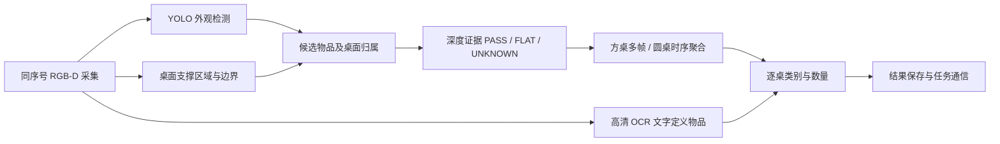

# TableSight · 桌面场景中的 RGB-D 物品感知

<p align="center"></p>

**从真实比赛中的误检、遮挡、贴纸、域偏移与部署约束出发，构建可解释的桌面物品识别与计数系统。**

2026 年机器人视觉竞赛项目整理 · **国家二等奖（团队成绩，作者反馈）** · 中文技术复盘与研究素材库

> 当前为**私有整理稿**。正式赛事全称、证书、团队分工和演示视频由作者后续补充。
> 已有实测、开发记录、整理推断、实验未部署四种信息分别标记；未完成的工作不列作参赛成果。

## 项目解决什么问题

输入一组 RGB-D 图像，识别并统计**目标桌面上的物品**。任务同时包含静止方桌、旋转圆桌、背景同类物品、二维贴图、透明包装、小目标与文字定义物品。

单帧图像中的“看起来像某物”和任务中的“真实位于这张桌上”存在差别。系统将外观检测、桌面区域、深度证据和时间证据分别建模，再生成逐桌计数结果。



## 值得关注的工作

| 主线 | 实际工作 | 阅读入口 |
|---|---|---|
| 数据驱动改进 | 困难场景补拍、场景分组、样本优先级、固定核心验证集 | [数据与补拍](docs/03-data-and-capture.md) |
| 模型迭代 | YOLOv8m 训练与微调，V6–V9 同集比较，保留回退版本 | [模型与权重](docs/04-model-iterations.md) |
| 桌面归属 | 透视梯形方桌、旋转圆桌、后方垫高干扰物 | [案例库](docs/07-casebook.md#几何与支撑区域) |
| 深度不确定性 | 贴纸、透明瓶、反光、遮挡与有效深度不足 | [融合架构](docs/02-architecture.md) |
| 时序一致性 | 按有效桌面帧计票、实例级聚合、旋转和容量竞争 | [案例库](docs/07-casebook.md#时序计数与一致性) |
| 边缘可靠性 | PT→ONNX→OM 一致性核对、CPU/NPU 分工、有限等待与结果归档 | [部署复盘](docs/06-edge-deployment.md) |

**命名说明：V6、V7、V8、V9 是本项目的权重迭代编号；这些阶段的已核验基础架构均为 YOLOv8m，V9 不代表 YOLOv9。**

## 已有证据支持的模型改进

下列每行均在对应的**同一组图像与标签**上比较两个版本。不同表行不能串成一条统一测试集增长曲线。

| 对比 | 验证范围 | 旧版 mAP50–95 | 新版 mAP50–95 | 变化 |
|---|---|---:|---:|---:|
| V6 → V7 | 固定 718 张，832 输入 | 64.58% | 68.92% | +4.34 pp |
| V6 → V7 | 固定 718 张，640 输入 | 60.83% | 65.73% | +4.90 pp |
| V7 → V8 | 现场 149 张，832 输入 | 51.80% | 71.73% | +19.93 pp |
| V8 → V9 | 新现场 57 张，832 输入 | 56.64% | 68.62% | +11.97 pp |

增量按原始未四舍五入数值或历史报告记录；pp 表示百分点。V7/V8/V9 同时涉及数据、标签处理、采样与微调，**不将总提升归因于单个因素**。现场验证集参与过模型选择；它们不是独立竞赛测试集。旧专项确实存在回退，详见[完整结果与限制](docs/05-evaluation.md)。

## 从哪里开始读

1. **想了解项目：**[项目定位](docs/01-positioning.md) → [系统架构](docs/02-architecture.md)。
2. **想挑选材料：**[选材指南](docs/00-reading-and-selection.md) → [完整案例库](docs/07-casebook.md) → [案例筛选表](artifacts/case-selection.csv)。
3. **想看模型提升：**[训练迭代](docs/04-model-iterations.md) → [评估解释](docs/05-evaluation.md) → [原始数值表](artifacts/model-comparisons/README.md)。
4. **想补科研实验：**[研究问题与实验计划](docs/10-research-plan.md)。
5. **准备发布：**[视频补拍](docs/11-demo-plan.md) → [贡献分工](docs/12-contributions.md) → [公开清单](docs/13-publication-checklist.md)。

## 现在可以运行什么

仓库提供**不依赖相机、NPU 或模型权重的计数评估与训练采样清单工具**：

```bash
python -X utf8 -m pip install -e .
python -X utf8 -m tablesight.evaluate examples/counting_demo.jsonl
python -X utf8 -m tablesight.sampling examples/sampling_demo.csv --output weighted_train.txt
python -X utf8 -m unittest discover -s tests -v
```

示例数据是人工构造的工具演示，**不用于证明项目精度**。计数评估输出逐桌完全正确率、数量 MAE、分组重复一致性和背景误计率；采样工具明确区分唯一训练图片与加权条目，并拒绝验证图进入训练清单。

`reference/competition_snapshot/` 保存经过范围筛选的本地算法参考快照，供阅读和后续重构。**它不等于已完成的跨设备安装包**；模型、完整数据、OpenNI/Ascend SDK 和现场通信配置不随库分发。参见[参考源码说明](reference/README.md)。

## 当前版本边界

- 已核对的训练基础：YOLOv8m；检测类表为 16 类常见物品＋TABLE。
- OCR 识别四种文字定义物品：语文、数学、洗洁精、沐浴露。
- 历史板端：Orange Pi AI Pro / Ascend 310B4，Astra Pro RGB-D；硬件信息来自项目交接记录。
- 2026-10-17 方桌后沿专项修改有开发回放与有限七帧实测记录，不能当作所有场景的可靠性证明。
- **全图 OCR 兜底与每桌最多一个 OCR 物品的方案曾开发和验证，最终被取消，未部署到已确认比赛版本。**
- 国家二等奖是团队赛事成绩；不是本仓库新增工具或事后整理实验的评测结果。

## 演示与后续补充

- [ ] 补充获奖证书及官方赛事全称。
- [ ] 补拍系统全流程、贴纸、后沿垫高物、圆桌遮挡与真实板端运行视频。
- [ ] 完成独立测试集和模块消融；现阶段不提供虚构的全系统准确率。
- [ ] 确认成员分工、代码权利和依赖许可证后再公开。

作者与维护账号：[rickyx123](https://github.com/rickyx123)。团队成员与个人贡献待作者填写。
