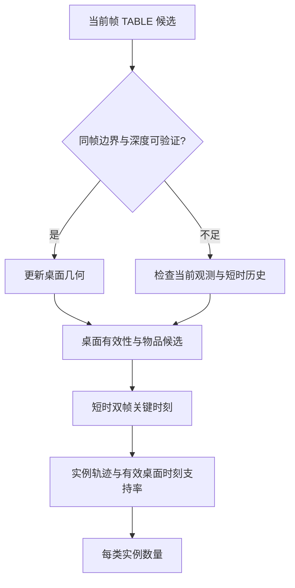

# 系统架构与数据流

## 数据与计算职责

RGB-D 采集端输出配对图像、序号、时间信息和采集状态。检测走 Ascend OM，深度几何与 OCR 主要在 CPU 上运行。高清 RGB 供文字识别与预览，检测仍使用部署约定的输入。

“480p”描述参考 RGB/深度画面；检测模型输入经过固定 640×640 预处理；高清旁路可以达到 2048×1536。三个尺寸必须分别记录，不能互相替代。

## 方桌

1. 检测 TABLE 与候选物品。
2. 从同帧深度估计桌面支撑，结合图像桌沿形成透视四边形。
3. 按四边形筛选物品归属；后沿不因“看起来高度接近”而任意扩张。
4. 用后台深度任务处理同序号候选；将 PASS、FLAT、UNKNOWN 保留为证据。
5. 对有限帧做实例融合，生成计数，合并已确认 OCR 文本类别。

## 圆桌

圆桌外观随偏心转动、遮挡和视角改变而变化。定位从当前帧检测出发，使用深度/图像边界与短时一致性限制异常膨胀，不能永久锁死第一个框。

双帧是一个关键时刻的确认机制，不意味着出现两次就计两个物品。眼镜在后期单独放宽了双帧确认，其他类别仍需按实际配置解释。

## 深度语义

| 状态 | 含义 | 不应直接推断的内容 |
|---|---|---|
| PASS | 在当前规则下存在可归属于本物体的立体证据 | 容量、品牌、必然位于真实桌板上 |
| FLAT | 有足够可靠的平面/贴图证据 | 所有低高度物都必然是假物 |
| UNKNOWN | 深度缺失、遮挡、有效区域少或证据冲突 | 物品不存在、物品是贴纸 |

历史“高度”多为相机射线相对拟合面的残差，并不自动等于重力方向的真实物理高度。将距离值解释为真实高度时，需要相机内参与坐标系定义。

## OCR 与物品归属

参赛阶段 OCR 读取语文、数学、洗洁精、沐浴露，支持不完整但可归类的文字。其裁剪、文字有效范围、预算和 YOLO 排除是不同环节：读出了字也可能未进入结果，未读出字也可能是区域先被拒绝。

全图兜底和每桌一个 OCR 的后续方案被取消，不能在本架构图中标成正式部署模块。
